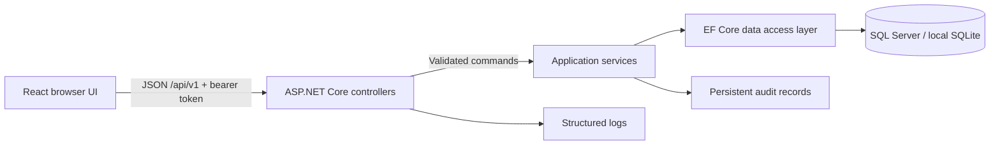
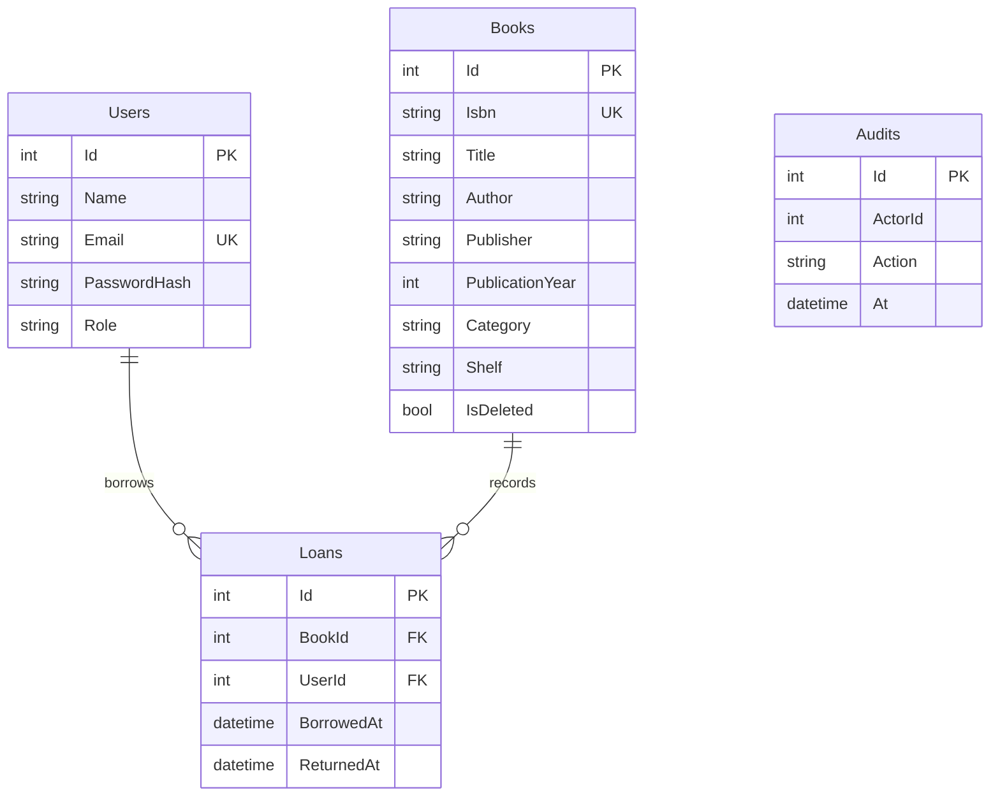

# Architecture and data model

## Boundaries and decisions
React owns presentation and local state. ASP.NET Core API controllers bind and validate request DTOs, enforce authorization, and delegate to injected service interfaces. AuthService, BookService, LoanService, and ReportingService own application operations and business rules. EF Core LibraryDb and entity configurations handle persistence, unit-of-work transactions, and relational constraints. Controllers never query DbContext directly. Explicit response DTOs keep database entities out of the API contract. See [backend structure](backend-structure.md) for the file layout.

Each book record is one physical copy with a unique ISBN (assessment simplification). Availability is derived from active loans, avoiding duplicate state. A filtered unique index guarantees one active loan per book even under concurrent requests. Removal is a soft delete; foreign keys preserve historical transactions. Loan records join the current book/member information; metadata is not a historical snapshot. All stored dates are UTC.

Public registration always creates Member accounts. Librarian is the administrator role. Only librarians can edit inventory, list members, assign to another user or inspect all loans/audits. Members can return only their own loans. Passwords use ASP.NET Identity's salted PBKDF2 hasher; JWTs expire after two hours, are held in sessionStorage, and are validated for signature, issuer, audience and lifetime. Authentication endpoints are rate limited. A production deployment should terminate TLS at the reverse proxy and provision secrets through a secret manager.

Expected domain errors return status-specific JSON; unexpected failures return a generic message with a trace ID and log the internal exception. Successful changes write persistent audit entries. Request-specific catalog data is not cached so availability stays current. The API uses no permissive cross-origin policy: Vite/nginx proxy requests through the same origin.

Schema creation uses EnsureCreated for this assessment. Apply docs/schema.sql manually to an empty SQL Server database OR let the API initialize it; do not do both. Before schema evolution in production, adopt reviewed EF migrations. Health is a liveness endpoint, not a database readiness probe.
